# Task Table

**Ekip görevlerini iki net kutuda tutan, davetle girilen sade bir görev tablosu.**
Bir görev ya *şimdi* yapılır ya da *sonraya* planlanır. Başka hiçbir şey ekranı kalabalıklaştırmaz.

Canlı adres: **https://task.suleymankara.com**

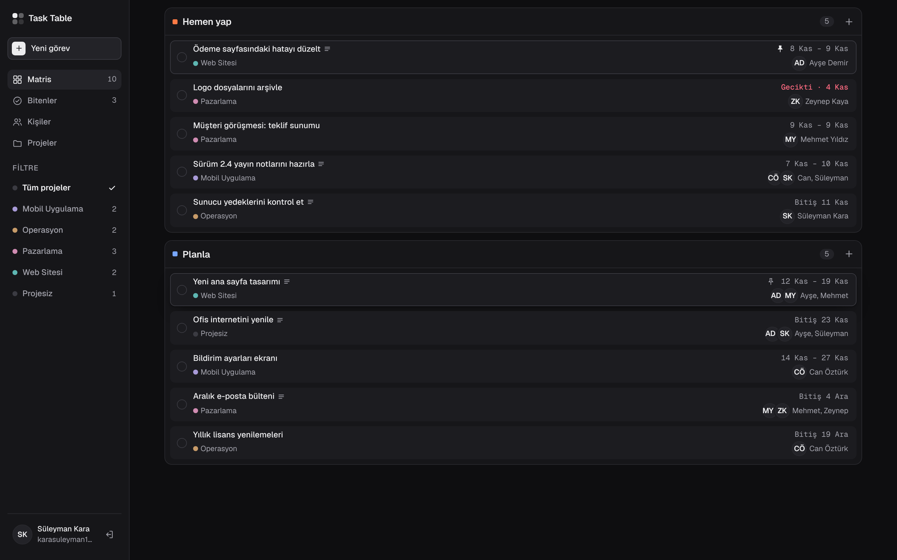

## Neler yapar?

- **İki bölümlü liste:** üstte **Hemen yap**, altında **Planla**. Kartları iki bölüm arasında sürükleyip bırakarak taşıyın.
- **Projeler ve renkler:** Her görev bir projeye bağlanır (ya da *Projesiz* kalır). Sol menüden (telefonda üstteki çiplerden) projeye göre süzün.
- **Sorumlular ve tarihler:** Bir göreve birden çok kişi atanır; başlangıç/bitiş tarihi gg.aa.yyyy biçiminde girilir, geciken görevler kırmızı görünür.
- **Sabitleme ve geri alma:** Önemli kartı sabitleyin; tamamladığınız görevi 4 saniye içinde geri alın, sonra **Bitenler** sayfasından da geri getirebilirsiniz.
- **Davetle giriş:** Üyeler e-postalarına gelen tek kullanımlık bağlantıyla girer; **Kişiler** listesinde olmayan bir adres giremez. Yönetici e-posta ve şifreyle girer.
- **Roller:** Yönetici, düzenleyici ve görüntüleyici. Yetkiler sunucuda uygulanır.
- **Çevrimdışı çalışır:** Bağlantı yokken yaptığınız değişiklikler cihazda saklanır, bağlantı gelince gönderilir.
- **Telefona uygun:** Aynı uygulama masaüstünde kenar çubuğu, telefonda alt sekme çubuğu ile açılır.

## Ekranlar

| | |
|---|---|
| 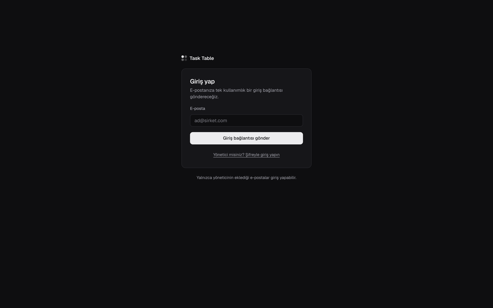 **Giriş.** E-posta bağlantısıyla | 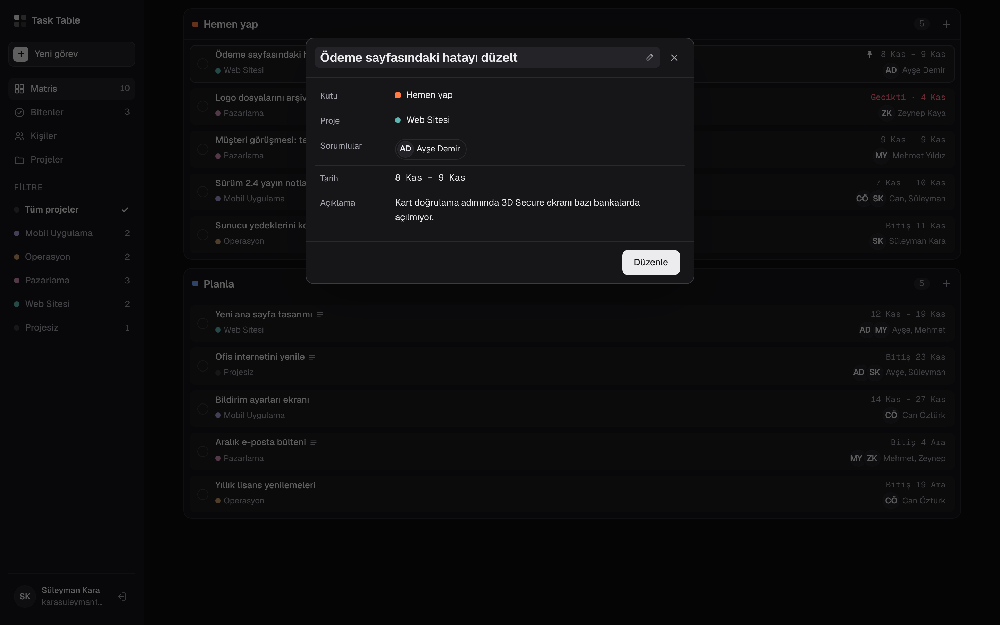 **Görev ayrıntısı.** Karta tıklayınca |
| 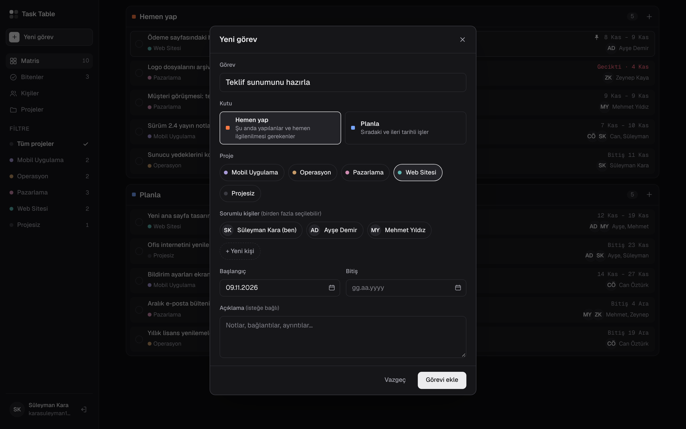 **Yeni görev.** Kutu, proje, sorumlular, tarihler | 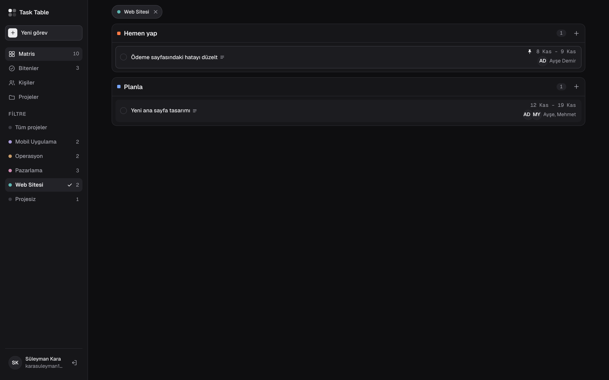 **Proje filtresi.** Yalnızca seçili projenin görevleri |
| 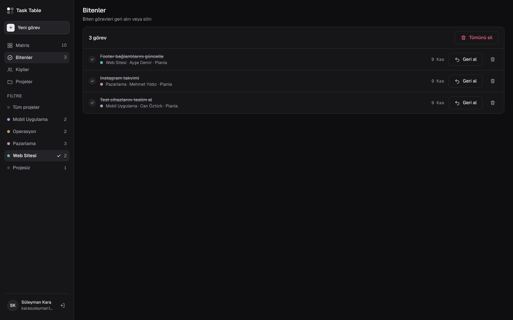 **Bitenler.** Geri al ya da sil | 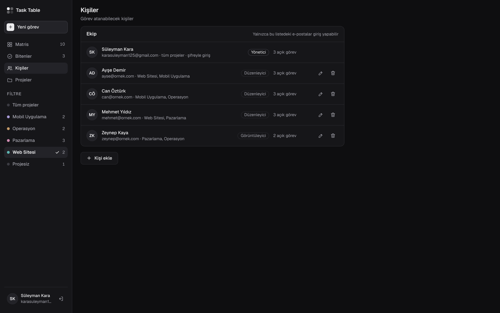 **Kişiler.** Davet, izin ve proje erişimi (yönetici) |
| 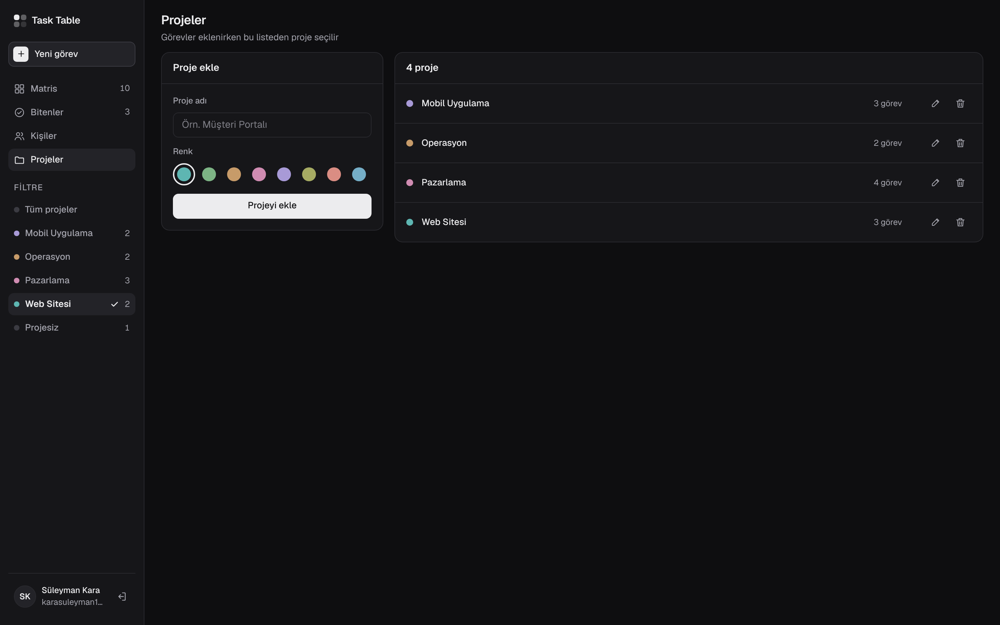 **Projeler.** Ad ve renk (yönetici) | |

### Mobil

<p>
  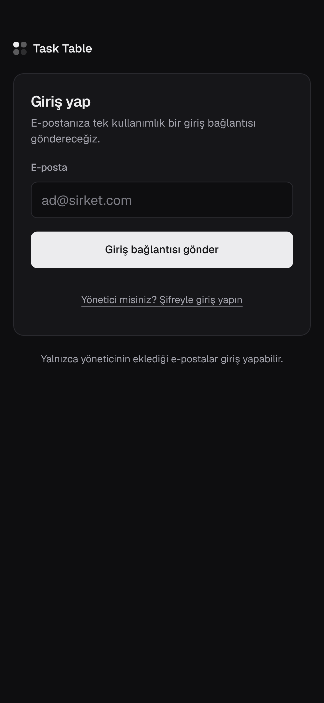
  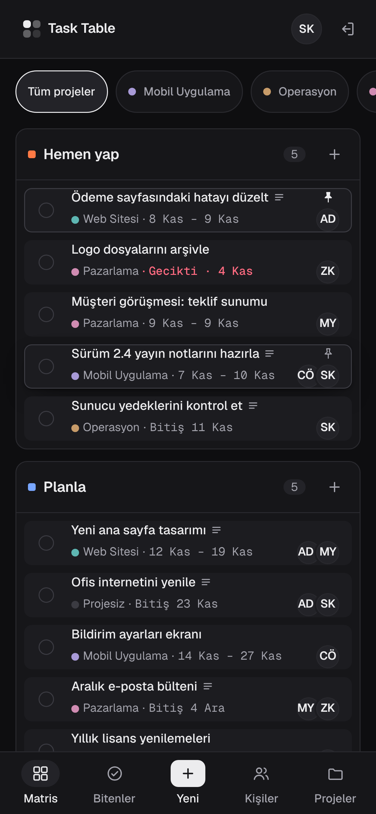
  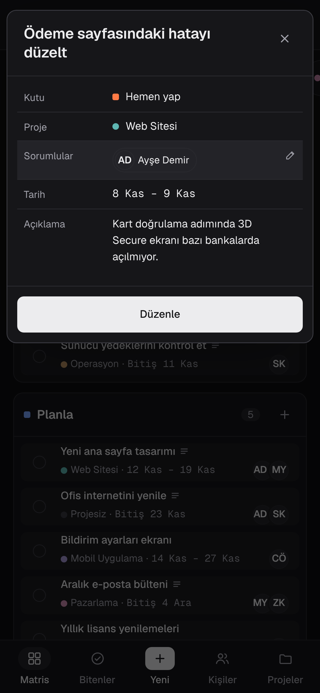
</p>

> Ekran görüntüleri örnek verilerle, yerel Firebase emülatöründe alınmıştır.

## Roller

| Rol | Ne yapabilir |
|---|---|
| Yönetici | Her şey. Kişi ve proje ekler, düzenler, siler |
| Düzenleyici | Kendi projelerindeki görevleri görür, ekler, düzenler, tamamlar |
| Görüntüleyici | Kendi projelerindeki görevleri yalnızca görür |

Projesiz görevleri yalnızca yönetici ve o göreve atanan kişiler görür.
Bu kurallar `firestore.rules` ile sunucuda uygulanır; testleri `tests/rules.test.ts` içindedir.

## Teknoloji

- React 19 + TypeScript + Vite
- Firebase Authentication: üyeler e-posta bağlantısıyla, yönetici şifreyle girer
- Cloud Firestore: çevrimdışı önbellek açık
- Firebase Hosting

## Kurulum ve yayınlama

Adım adım Firebase kurulumu, alan adı bağlama ve ilk kullanım için: **[docs/SETUP.md](docs/SETUP.md)**

Kısaca (Node.js 20+):

```bash
npm install
npm run dev        # geliştirme sunucusu
npm run build      # üretim derlemesi
npm run deploy     # derle ve Firebase'e yükle
```

### Yerelde deneme (emülatör)

Gerçek Firebase projesine dokunmadan denemek için (Java gerekir):

```bash
npx firebase emulators:start --only auth,firestore --project demo-task-table
```

Başka bir terminalde:

```bash
VITE_USE_EMULATORS=1 npm run dev
```

### Testler

```bash
npm run test:rules   # güvenlik kuralı testleri (emülatörle)
npm run test:e2e     # uçtan uca test (emülatör + dev sunucusu açıkken, Playwright gerekir)
```

## Klasörler

```
src/
  auth/      giriş ekranı, oturum, giriş işlemleri
  app/       uygulama iskeleti, liste, kartlar, görev pencereleri
  pages/     Bitenler, Kişiler, Projeler
  data/      Firestore'dan canlı veri (store) ve yazma işlemleri (actions)
  lib/       tarih ve kişi yardımcıları
  styles/    tasarım değişkenleri ve stiller
firestore.rules   veritabanı erişim kuralları
design/           tasarım prototipi ve ekran listesi (design/SCREENS.md)
docs/             kurulum rehberi ve ekran görüntüleri
tests/            kural testleri ve uçtan uca test
```

## Tasarım

Tüm ekranlar masaüstü (1440×900) ve mobil (390×844) olarak tasarlandı. Ekran listesi: [design/SCREENS.md](design/SCREENS.md).
